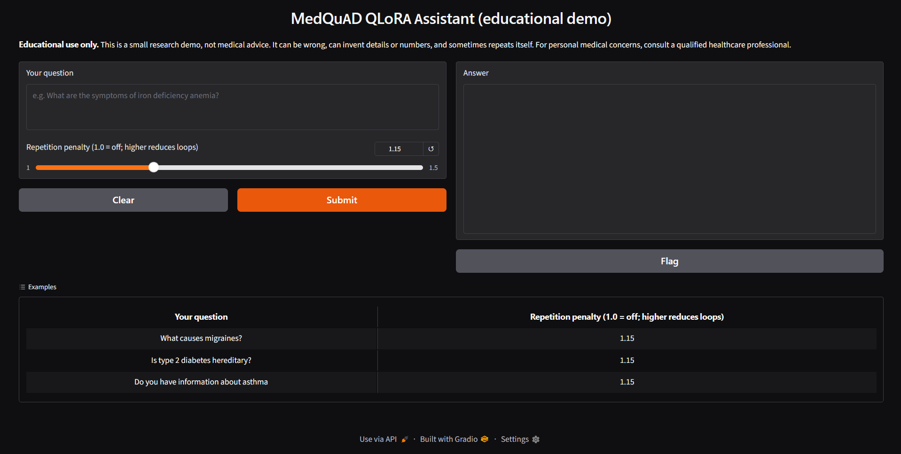
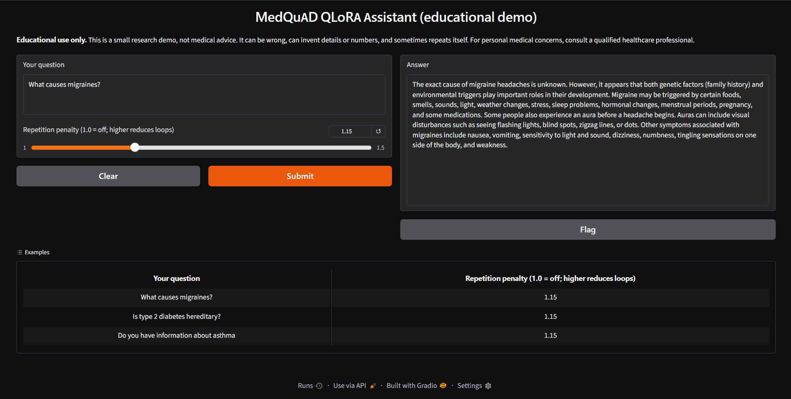
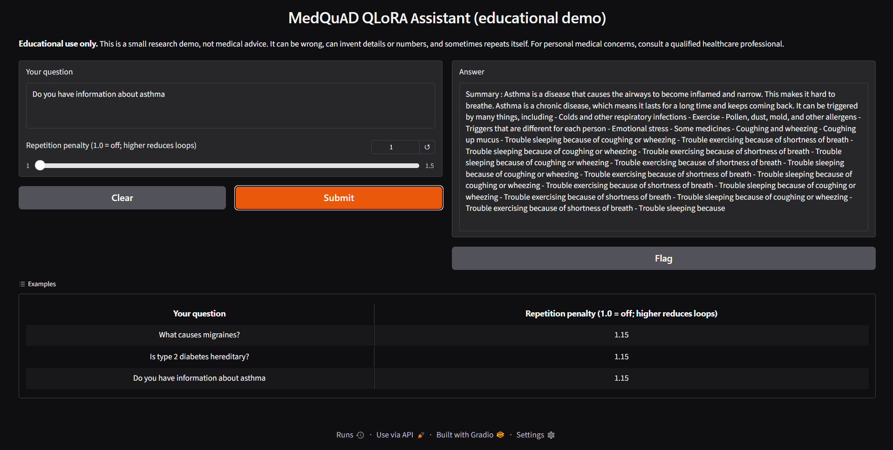

# qlora-medical-assistant

QLoRA fine-tuning of Qwen2.5-1.5B-Instruct on medical Q&A (MedQuAD), with a base vs. fine-tuned evaluation on a held-out set and a Gradio demo.

> **Educational use only. This is not medical advice.** The model can be wrong, can invent details or numbers, and sometimes repeats itself. For personal medical concerns, consult a qualified healthcare professional.

## What this project shows

- A complete small fine-tuning pipeline: data preparation, 4-bit QLoRA training, evaluation, and a demo.
- Honest evaluation: a leak-free held-out set, fixed seeds, simple metrics, and a documented list of failure modes.
- **Main finding:** fine-tuning moved the model's answers toward the MedQuAD style (lower loss, higher ROUGE-L). It did **not** make the model more medically accurate, and it introduced repetition loops and boilerplate openings (see Limitations).

## Pipeline

| Stage | File | Output |
|---|---|---|
| 1. Data | `prepare_data.py` | `data/train.jsonl`, `data/eval.jsonl`, `results/data_stats.json` |
| 2. Training | `train.py` | LoRA adapter on Hugging Face (private), `logs/train_config.json`, `logs/train_log.json` |
| 3. Evaluation | `evaluate.py` | `results/eval_metrics.json`, `results/eval_samples.jsonl` |
| 4. Demo | `app.py` | Gradio app |

Each stage reads only the previous stage's saved output, so the project can be paused and resumed between stages.

## Data

Dataset: [`keivalya/MedQuad-MedicalQnADataset`](https://huggingface.co/datasets/keivalya/MedQuad-MedicalQnADataset) (MedQuAD, answers from NIH web pages), 16,407 rows.

| Step | Rows left |
|---|---|
| Loaded | 16,407 |
| After removing duplicate questions | 14,345 |
| After removing duplicate answers | 13,813 |
| After keeping answers of 50 to 1,500 characters | 9,719 |
| Final split (seed 42) | 2,500 train, 200 held-out |

Duplicates are removed **before** the split, so near-copies of a training example cannot end up in the held-out set. The script also asserts that no question or answer appears in both sets. The held-out set is read only by `evaluate.py`.

The `data/*.jsonl` files are not committed. Running `prepare_data.py` regenerates them identically because the seed is fixed.

## Training

| Setting | Value |
|---|---|
| Base model | Qwen/Qwen2.5-1.5B-Instruct, loaded in 4-bit (NF4) |
| Method | LoRA, r=16, alpha=32, dropout 0.05, on all attention and MLP projections |
| Loss | Answer tokens only (prompt/completion format) |
| Epochs | 1 (157 steps) |
| Batch | 4 per step x 4 accumulation = 16 effective |
| Learning rate | 2e-4, cosine schedule, 10 warmup steps |
| Max length | 512 tokens (longest training example: 445) |
| Precision | fp16 (T4 has no bf16) |
| Seed | 42 |
| Trainable parameters | 18,464,768 |
| Training time | 13.29 min on one Kaggle T4 |
| Peak GPU memory | 2.71 GB |
| Mean training loss | 1.303 |

Training loss is measured on training data, so it does not show improvement on unseen questions. That is what the evaluation below is for.

## Evaluation (200 held-out examples)

Base and fine-tuned use the same loaded model. The "base" row is the same model with the adapter switched off. Generation is greedy (no sampling), capped at 300 new tokens, with no repetition penalty.

| Metric | Base | Fine-tuned |
|---|---|---|
| Loss on reference answers | 1.7426 | 1.2353 |
| Perplexity | 5.712 | 3.439 |
| ROUGE-L (mean) | 0.1843 | 0.2719 |
| Mean generated words (reference: 102.0) | 139.5 | 114.5 |
| Answers hitting the 300-token cap (approx.) | 44 | 54 |

- Mean ROUGE-L difference (fine-tuned minus base): **+0.0876**, 95% bootstrap interval 0.0589 to 0.1182. The fine-tuned model scored higher on 123 of 200 questions and lower on 77. This interval only reflects which 200 questions were sampled. It does not cover a different seed or training run.
- Evaluation time: 21.23 min.

### What the metrics mean, and their limits

- **Loss / perplexity:** how well the model predicts the reference answer's tokens. It measures closeness to MedQuAD wording and style, not medical correctness.
- **ROUGE-L:** word overlap between a generated answer and the reference. A correct answer in different words scores low, and a wrong answer that copies the reference's wording can score high.
- Both metrics are style-and-wording measures. Neither measures correctness or safety.

## Limitations (found by reading the outputs)

1. **Wrong answers can score well.** For one held-out question (spondylocarpotarsal synostosis), the reference says autosomal *recessive* inheritance. The fine-tuned model said *dominant*, which is wrong, yet scored ROUGE-L 0.3432 against the base model's 0.1717 because it copied the reference's phrasing. (The base model was also wrong.)
2. **Repetition loops.** A rough heuristic (two or more repeated sentences) flags 8 base answers and 25 fine-tuned answers. The longest fine-tuned answers end by repeating one sentence until the token cap.
3. **Boilerplate openings.** About 10% of training answers (254 of 2,500) start with "These resources address...". The fine-tuned model produced that opening on 40 of 200 held-out answers (20%), the base model on 0. On those 40 questions the ROUGE-L gain was larger (0.2795 vs 0.1177 for base) than on the other 160 (0.2700 vs 0.2010). The gain on the other 160 shows the improvement is not only from the boilerplate. This split is descriptive, not a controlled experiment.
4. **Length matching.** Fine-tuned answers are closer to the reference length, which also raises overlap scores, so not all of the ROUGE-L gain is "better content".
5. **Possible invented figures.** In a quick demo check, the model stated specific percentages for diabetes inheritance risk that were not verified.
6. **Source artifacts.** Some answers copy MedlinePlus-style patterns such as "Summary :" or a trailing "NIH: ..." line.
7. **Scope.** One run, one seed, 200 examples, held-out set from the same source as the training data, so it measures in-distribution style, not general medical ability. Answers longer than 1,500 characters were filtered out of training and evaluation.
8. Fine-tuning here teaches style and format, not new medical knowledge.

## Demo



Default setting (repetition penalty 1.15):



Repetition penalty set to 1.0, showing the loop:



The demo uses a repetition penalty of **1.15** by default, a demo choice made after reading outputs for four questions of my own (not the held-out set). It is not a tuned value, and all evaluation numbers above use no penalty. The slider lets a viewer set it back to 1.0.

The demo needs a GPU (4-bit loading), so it runs on Kaggle with a temporary Gradio share link. It is not permanently hosted.

## How to reproduce (Kaggle, free T4)

1. Create a notebook with GPU T4 and Internet on. Add `HF_TOKEN` to Kaggle Secrets (write access).
2. Clone this repo, then install `requirements.txt`.
3. Run in order:

```bash
python prepare_data.py
python train.py          # pushes the adapter to a private Hugging Face repo
python evaluate.py       # add --limit 8 for a quick smoke test
python app.py            # launches the Gradio demo
```

Versions that actually ran are pinned in `requirements.txt` (Kaggle, Python 3.13, one T4 used). `train.py` and `evaluate.py` hide the second T4 with `CUDA_VISIBLE_DEVICES=0`.

## Repository layout

```
prepare_data.py   build the leak-free train/eval split
train.py          QLoRA training, pushes the adapter to Hugging Face
evaluate.py       base vs fine-tuned on the held-out set
app.py            Gradio demo
requirements.txt  versions that ran
results/          data stats, evaluation metrics, per-question samples
logs/             training config and loss log
assets/           demo screenshots
```

## Data source and license

Data: MedQuAD, from "A Question-Entailment Approach to Question Answering", Asma Ben Abacha and Dina Demner-Fushman, BMC Bioinformatics, 2019. The original repository is https://github.com/abachaa/MedQuAD and it is published under [CC BY 4.0](https://creativecommons.org/licenses/by/4.0/). The answers originate from NIH websites.

I used the Hugging Face copy `keivalya/MedQuad-MedicalQnADataset`, which declares no license itself. The terms above come from the original repository.

**Changes made:** whitespace cleaned and doubled question marks fixed, duplicate questions and answers removed, answers filtered to 50 to 1,500 characters, subsampled to 2,500 training and 200 held-out examples, and reformatted into a chat format.

This project is not endorsed by the MedQuAD authors or the NIH. The original authors removed the answers of three MedlinePlus subsets for copyright reasons. I have not verified which subsets the Hugging Face copy contains.

Base model: [Qwen/Qwen2.5-1.5B-Instruct](https://huggingface.co/Qwen/Qwen2.5-1.5B-Instruct), licensed under Apache 2.0 (Copyright 2024 Alibaba Cloud). The adapter in this project is a modification and is not endorsed by Qwen or Alibaba Cloud.